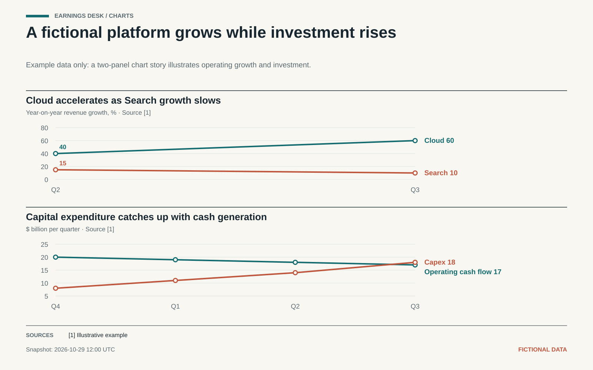

# Skills for the work behind the work

A growing collection of practical AI skills for research, analysis, and the recurring tasks that deserve a better workflow.

Built for real use. Shared for anyone who finds them useful.

[Explore the skills](#skills) · [Install in Codex](#install-in-codex) · [How skills work](#how-skills-work)

---

## Skills

### Earnings Desk

**Go beyond the headline earnings beat.**

Turn a quarterly release into an evidence-led breakdown: a quick earnings wire, financial grades, an earnings-call readout, market reaction, and a chart-led visual.

- **Earnings wire:** a quick scan of the numbers and guidance that matter.
- **Report card:** separate grades for operating performance and financial resilience.
- **Inside the call:** management's messages, analyst questions, and unanswered questions.
- **Market verdict:** a sourced look at the reaction, with facts separated from inference.
- **Chart story:** editorial charts selected to explain the quarter's central tension.
- **Saved reports:** Google Drive or a verified private Git repository when configured, with a local fallback.

**Try asking:**

> Use $earnings-desk to analyze Microsoft's latest earnings and explain what mattered most. Include the call and market reaction if they are available.

[Explore Earnings Desk →](skills/earnings-desk/)

<details>
<summary>See an example chart story</summary>



*Fictional company and synthetic data. This is a format demonstration, not investment research.*

</details>

Earnings Desk needs access to current sources for a current report; consensus estimates, transcripts, and market data depend on the tools and sources available to your agent. It identifies missing information rather than inventing it.

## Install in Codex

Ask Codex:

```text
$skill-installer install https://github.com/immeramarbeiten/skills/tree/main/skills/earnings-desk
```

Restart Codex to pick up the installed skill. Then use `$earnings-desk` in a prompt, or ask for a matching task. Review a skill and its scripts before installing or running them.

## How skills work

A skill is a folder of instructions and optional supporting files that an AI agent can use for a particular task. Each one has a `SKILL.md` describing when and how to use it. This repository keeps each skill self-contained under `skills/`.

```text
skills/
└── earnings-desk/
    ├── SKILL.md
    ├── references/
    ├── scripts/
    ├── assets/
    └── tests/
```

## License

No license has been selected yet. Public visibility alone does not grant permission to reuse the contents.
